# CarFit Database Entity-Relationship Diagram (ERD)

This document contains the complete structural relationship graph for the CarFit platform's database, generated directly from the Entity Framework Core `CarFitDbContext`.

## Architecture Overview
The database is structured around a few key domains:
1. **Identity & Users:** Everything branches from the `ApplicationUser` (ASP.NET Identity), which can extend into a `UserProfile` (Buyer) or a `Seller` (Dealer).
2. **Inventory & Cars:** The core entity is `Car`, which acts as a master record. A `CarListing` is the public-facing advertisement for that car.
3. **Inspections:** Linked directly to the `Car` and tied to `Mechanic` profiles.
4. **Billing:** Stripe subscriptions and pay-per-post transactions.

> [!NOTE]
> The diagram below uses Mermaid syntax. In Mermaid ERD:
> * `||--o{` means "One to Zero-or-Many" (1:N)
> * `||--||` means "One to One" (1:1)
> * `||--o|` means "One to Zero-or-One" (1:0..1)

```mermaid
erDiagram
    %% Identity and Users Layer
    ApplicationUser {
        string Id PK
        string PhoneNumber
        bool PhoneIsPlaceholder
    }
    UserProfile {
        int ProfileId PK
        string UserId FK
        decimal BudgetMin
        decimal BudgetMax
        string TransmissionPref
    }
    Seller {
        int Id PK
        string IdentityUserId FK
        string Name
        string Tier
        bool IsApproved
    }

    %% Core Inventory Layer
    Car {
        int Id PK
        string Make
        string Model
        int Year
        decimal Price
        string BodyType
    }
    CarListing {
        int Id PK
        int CarId FK
        int SellerId FK
        string Status
        decimal ListingPrice
    }
    CarImage {
        int Id PK
        int CarId FK
        string Url
        bool IsPrimary
    }

    %% Inspection Layer
    InspectionReport {
        int CarId PK "FK"
        decimal OverallScore
        decimal CalculatedTrustScore
        bool IsRisky
    }
    SellerInspectionUpload {
        int Id PK
        int CarId FK
        string FilePath
    }
    Mechanic {
        int Id PK
        string Name
        string City
    }
    InspectionBooking {
        int Id PK
        int CarListingId FK
        int MechanicId FK
        string Status
    }

    %% User Activity & Logs Layer
    SavedResult {
        string UserId PK "FK"
        int CarId PK "FK"
    }
    RecommendationLog {
        int Id PK
        string UserId FK
        decimal Score
    }
    SearchLog {
        int Id PK
        string UserId FK
        string Term
    }
    Testimonial {
        int Id PK
        string UserId FK
        int Rating
        bool IsApproved
    }
    BuyerContactIntent {
        int Id PK
        int ListingId FK
        string BuyerUserId FK
        string SellerUserId FK
    }

    %% Billing & Stripe Layer
    SubscriptionPlan {
        int Id PK
        string PlanCode
        decimal AmountJod
    }
    Subscription {
        int Id PK
        string UserId FK
        int PlanId FK
        string StripeSubscriptionId
        string Status
    }
    PaymentTransaction {
        int Id PK
        string UserId FK
        int SubscriptionId FK
        int CarListingId FK
        string StripePaymentIntentId
        string Status
    }

    %% Lookups (Standalone)
    Make {
        int Id PK
        string Name
        string LogoUrl
    }
    InspectionTermsGlossary {
        string Term PK
        string ExplanationEn
        string ExplanationAr
    }
    ContactMessage {
        int Id PK
        string Email
        string Status
    }

    %% ---- RELATIONSHIPS ----

    %% Users
    ApplicationUser ||--o| UserProfile : "has 1 profile"
    ApplicationUser ||--o| Seller : "is optionally a"
    ApplicationUser ||--o{ SavedResult : "bookmarks"
    ApplicationUser ||--o{ SearchLog : "performs"
    ApplicationUser ||--o{ RecommendationLog : "has recommendations"
    ApplicationUser ||--o{ Testimonial : "writes"
    ApplicationUser ||--o{ Subscription : "subscribes to"
    ApplicationUser ||--o{ PaymentTransaction : "pays"
    ApplicationUser ||--o{ BuyerContactIntent : "initiates contact"

    %% Inventory
    Seller ||--o{ CarListing : "creates"
    Car ||--o{ CarListing : "is advertised via"
    Car ||--|| InspectionReport : "has 1"
    Car ||--o{ CarImage : "has images"
    Car ||--o{ SellerInspectionUpload : "has document uploads"
    Car ||--o{ SavedResult : "is bookmarked in"

    %% Inspections
    CarListing ||--o{ InspectionBooking : "receives requests for"
    Mechanic ||--o{ InspectionBooking : "performs"

    %% Transactions
    SubscriptionPlan ||--o{ Subscription : "defines"
    Subscription ||--o{ PaymentTransaction : "generates"
    CarListing ||--o{ PaymentTransaction : "is paid via (pay-per-post)"
    CarListing ||--o{ BuyerContactIntent : "receives"

```

